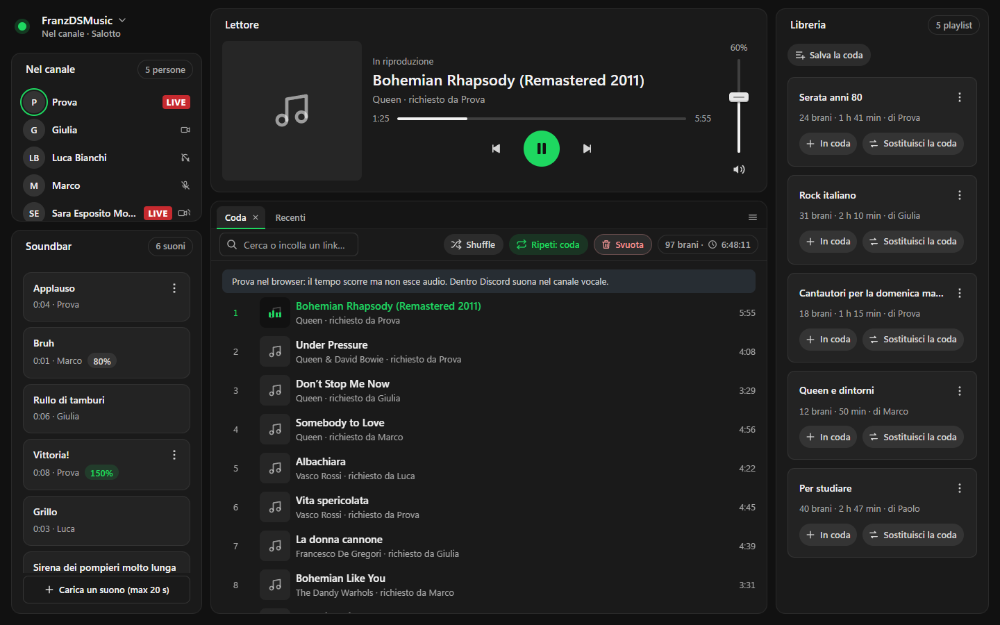
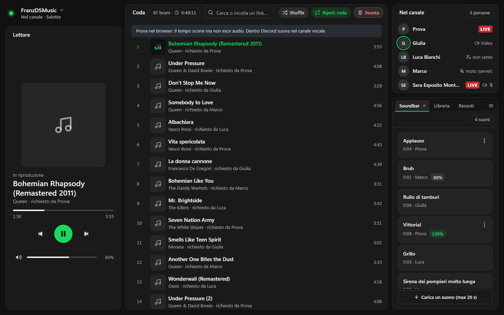
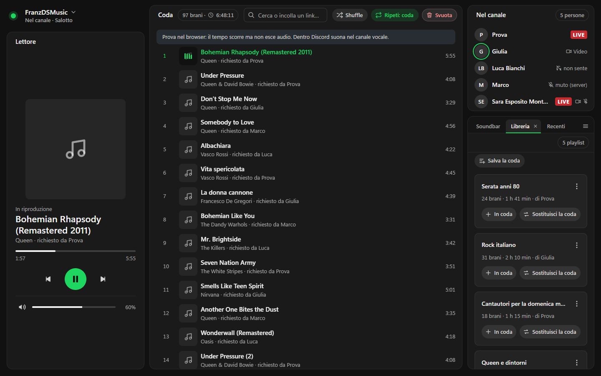
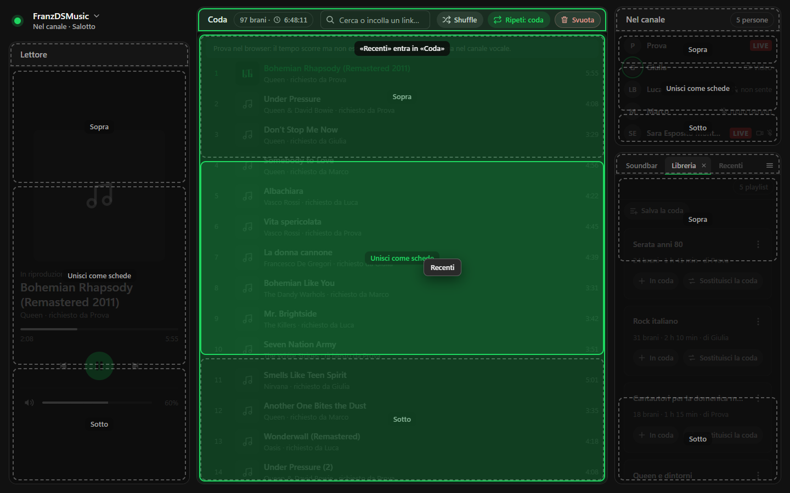
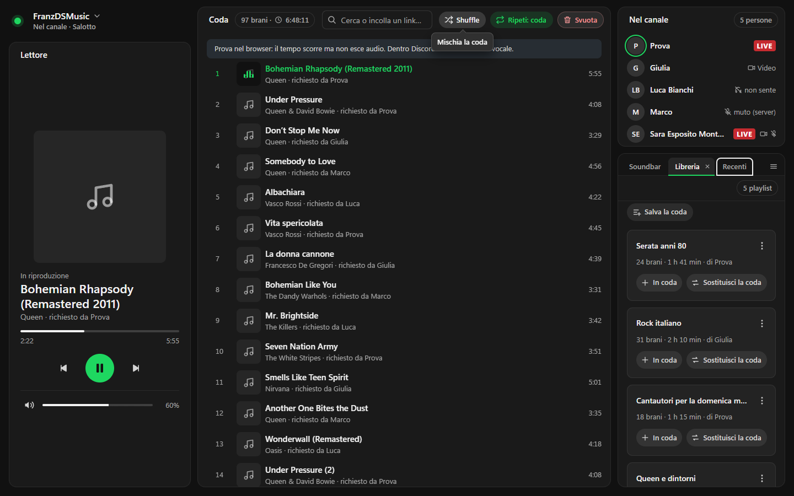
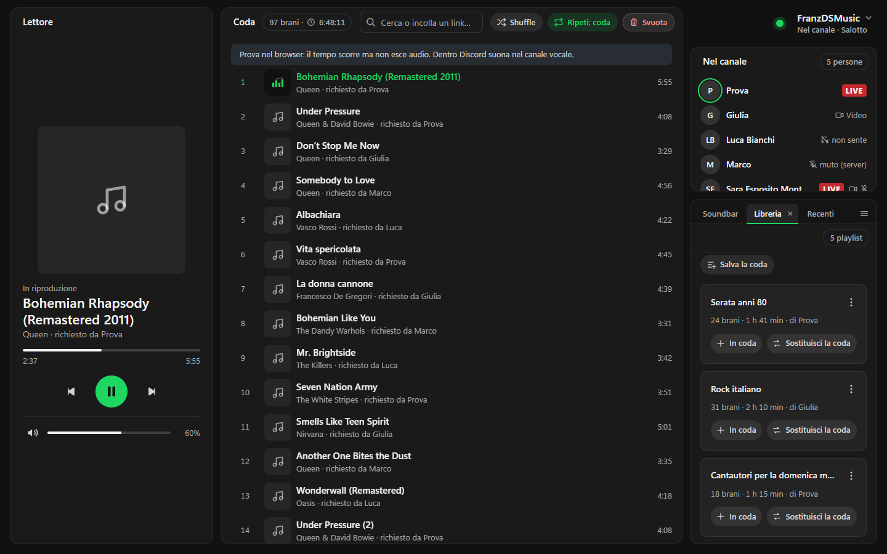

# FranzDSMusic

Bot musicale per Discord con un'interfaccia grafica che si apre come **Activity** (l'app web dentro il canale vocale). Solo audio, niente video.

Serve ad ascoltare musica insieme nel canale vocale e a comandare la coda da una vera interfaccia, non solo da chat.

## Schermate

Tutte prese in modalità anteprima (`?anteprima=1`), con dati finti.


Disposizione predefinita «Player orizzontale»: canale e soundbar a sinistra, lettore e coda al centro, libreria a destra.


Disposizione «Player verticale»: lettore alto a sinistra, coda al centro, canale e schede a destra.


Un pannello con più schede (Soundbar, Libreria, Recenti): sotto le linguette c'è la riga strumenti della scheda attiva.


Trascinando una linguetta compaiono le zone di rilascio: sopra, sotto o unita come scheda in un altro pannello.


Fumetto di suggerimento sui pulsanti.


L'intestazione si può spostare in uno dei quattro angoli dal suo menu.

## Riprodurlo a casa tua, in breve

1. Crea l'app nel Discord Developer Portal e invita il bot nel tuo server (sezione *Discord Developer Portal*).
2. Copia `.env.example` in `.env` e inserisci ID, segreto e token dell'app.
3. Avvia il bot con `docker compose up -d --build` su una macchina sempre accesa (sezione *Installazione e avvio con Docker*).
4. Rendi raggiungibile il bot in HTTPS: un tuo dominio (es. `tuo-dominio.example`) con un reverse proxy verso la porta 3001, oppure il tunnel di prova (sezione *Indirizzo HTTPS per l'Activity*).
5. Nel Developer Portal metti quel dominio in *Activities, URL Mappings*.
6. In Discord entra in un canale vocale, apri **Activities** (il razzo) e scegli la tua app.

## Cosa fa

- Aggiunge brani da link YouTube (video e playlist), SoundCloud e tutto ciò che `yt-dlp` sa leggere.
- Cerca su YouTube dal campo in alto: 10 risultati con copertina, canale e durata.
- Legge album e playlist Spotify pubblici (titolo e artista) e cerca ogni brano su YouTube.
- Per ogni brano o link ci sono tre scelte: **in coda**, **riproduci dopo**, **riproduci ora**.
- Comandi: play/pausa, salta, indietro, stop, rimuovi, riordina trascinando, mischia, ripeti (no / coda / brano), volume, vai a un punto del brano.
- Mostra gli ultimi brani ascoltati e li rimette in coda con un clic.
- Libreria di playlist condivisa per server: salva e ricarica la coda.
- **Soundbar**: suoni brevi caricati dall'Activity, che chiunque può far partire nel canale (la musica riprende dopo).
- Mostra chi è nel canale vocale e chi sta parlando.
- Scrive il brano in corso nello stato del canale vocale.
- Lo stato della coda è per server e arriva in tempo reale a tutti, via WebSocket.
- Il bot esce da solo se il canale resta vuoto o se non suona niente per un po'.
- La coda si salva su disco e torna dopo un riavvio (in pausa).
- Comandi slash e comandi da chat (messaggi nei canali musica o menzione del bot).
- Modalità prova: l'interfaccia funziona nel normale browser, senza Discord e senza audio.

## Comandi da chat

Comandi slash: `/play`, `/stop`, `/skip`, `/pausa`, `/coda`, `/vai`, `/precedente`, `/suono`.

Il bot legge anche i messaggi (serve il **Message Content Intent**):

| Dove | Cosa scrivere | Cosa succede |
|---|---|---|
| Canali musica (`MUSIC_TEXT_CHANNEL_ID`) | un link | va in coda |
| | un testo qualsiasi | primo risultato di YouTube, in coda |
| | `dopo <link o testo>` | va subito dopo il brano in corso |
| | `skip`/`salta`, `pausa`, `riprendi`, `stop`, `coda`, `indietro`/`precedente` | come i comandi slash |
| | `vai 1:30` (anche `vai 90`, `vai 1:02:03`) | va a quel punto del brano |
| Qualsiasi altro canale | menziona il bot e scrivi una delle cose sopra | la stessa cosa |

- Il bot entra nel canale vocale di chi scrive.
- Se è già in un altro canale con persone dentro, non si sposta e dice dove si trova.
- Riscontro: una reazione e una risposta breve con il titolo. Gli errori arrivano come risposta.
- I messaggi degli altri bot vengono ignorati.

## Tecnologie

| Parte | Cosa uso |
|---|---|
| Server | Node.js 22 o più recente, Express, `ws` (WebSocket) |
| Bot | `discord.js` e `@discordjs/voice` |
| Audio | `yt-dlp` per i link, `ffmpeg` per codificare in Opus |
| Interfaccia | React, Vite, `@discord/embedded-app-sdk` |
| Contenitori | Docker (immagini amd64 e arm64) |
| Tunnel (facoltativo) | `cloudflared` |

## Struttura delle cartelle

| Percorso | Contenuto |
|---|---|
| `server/src/index.js` | Express e WebSocket (`/ws`), API HTTP, serve l'interfaccia compilata |
| `server/src/music.js` | Coda e stato per server, riproduzione |
| `server/src/bot.js` | Bot Discord, canali vocali e testuali, registrazione dei comandi slash |
| `server/src/commands.js` | Comandi slash e comandi da chat |
| `server/src/resolver.js` | Link e ricerche con `yt-dlp`, Spotify |
| `server/src/audio.js` | `ffmpeg` e `yt-dlp` verso Opus per Discord |
| `server/src/audiocache.js` | Cache dei brani in RAM |
| `server/src/store.js` | Salvataggio della coda su disco |
| `server/src/playlists.js` | Libreria di playlist per server |
| `server/src/soundbar.js`, `suoni.js` | Player e libreria dei suoni brevi |
| `server/src/statocanale.js` | Stato del canale vocale |
| `server/src/auth.js` | Verifica di chi si collega |
| `server/src/heartbeat.js` | Battito del WebSocket |
| `server/test/` | Prove automatiche (`npm test`) |
| `client/src/` | Interfaccia React |
| `scripts/` | Tunnel `cloudflared` e script per leggerne l'indirizzo |
| `branding/` | Icona e copertina dell'Activity |
| `screenshots/` | Schermate usate in questo README |
| `Dockerfile`, `docker-compose.yml` | Immagine del bot e servizi `bot` e `tunnel` |

## Requisiti

| Programma | Note |
|---|---|
| Node.js | versione 22 o più recente (provato con 24) |
| yt-dlp | nel `PATH`, oppure `YTDLP_PATH` |
| ffmpeg (con `libopus`) | nel `PATH`, oppure `FFMPEG_PATH` |
| Docker | solo per l'avvio con Docker; dentro ci sono già Node, yt-dlp e ffmpeg |
| cloudflared | solo per il tunnel senza Docker |

## Discord Developer Portal

Portale: <https://discord.com/developers/applications>

| # | Dove | Cosa fare |
|---|---|---|
| 1 | **New Application** | Crea l'app. Da **General Information** copia l'*Application ID* in `DISCORD_CLIENT_ID` |
| 2 | **OAuth2** | Copia il *Client Secret* in `DISCORD_CLIENT_SECRET`. In **Redirects** aggiungi `https://127.0.0.1` (segnaposto richiesto dalla guida ufficiale) |
| 3 | **Bot** | **Reset Token** e copia il token in `DISCORD_BOT_TOKEN` |
| 4 | **Bot, Privileged Gateway Intents** | Attiva **Message Content Intent** (serve ai messaggi in chat e alle menzioni) |
| 5 | **Activities, Settings** | Spunta **Enable Activities** |
| 6 | **Activities, URL Mappings** | Prefisso `/` verso `tuo-dominio.example` (senza `https://`): l'indirizzo pubblico del tuo server |
| 7 | **OAuth2, URL Generator** | Scope `bot` e `applications.commands`. Permessi **Connect**, **Speak**, **Send Messages**, **Read Message History**, **Add Reactions** (più **Set Voice Channel Status** per lo stato del canale). Apri il link e invita il bot nel tuo server |

## Indirizzo HTTPS per l'Activity

L'Activity ha bisogno di un indirizzo HTTPS pubblico raggiungibile da Discord. Due strade:

| Strada | Come |
|---|---|
| Tuo dominio (consigliata) | Un reverse proxy con certificato HTTPS (Caddy, nginx, Traefik…) che inoltra `tuo-dominio.example` a `http://<macchina-del-bot>:3001`, WebSocket compresi (`/ws`). Poi `tuo-dominio.example` in *Activities, URL Mappings* |
| Tunnel di prova | `docker compose --profile tunnel up -d` e poi `sh scripts/indirizzo-tunnel.sh` (senza Docker: `npm run tunnel`). L'indirizzo `*.trycloudflare.com` cambia a ogni avvio |

Esempio minimo con Caddy (`Caddyfile`): `tuo-dominio.example { reverse_proxy 127.0.0.1:3001 }`.

## Installazione e avvio con Docker

Serve solo Docker. Il `.env` resta fuori dall'immagine: lo legge `docker compose` all'avvio.

```bash
cp .env.example .env     # poi compila i valori
docker compose up -d --build
```

| Cosa | Comando |
|---|---|
| Stato (il bot deve essere `healthy`) | `docker compose ps` |
| Log del bot | `docker compose logs -f bot` |
| Fermare | `docker compose down` |
| Riavviare | `docker compose restart` |
| Aggiornare yt-dlp | `docker compose build --no-cache bot && docker compose up -d` |
| Tunnel di prova | `docker compose --profile tunnel up -d`, poi `sh scripts/indirizzo-tunnel.sh` |

- Il tunnel di prova usa `cloudflared`: l'indirizzo `*.trycloudflare.com` cambia a ogni avvio e va ricopiato in *Activities, URL Mappings*.
- I container ripartono da soli (`restart: unless-stopped`).
- L'interfaccia risponde anche su <http://localhost:3001>.
- Non avviare anche `npm start` con lo stesso token: due bot si disturbano.
- La coda e le librerie stanno nel volume Docker `discord-music-dati` (`/app/data`). `docker compose down` non lo cancella, `docker compose down -v` sì.
- Il bot ha un limite di 768 MB di RAM, 1,5 CPU e `/tmp` in RAM. Con poca RAM metti `YTDLP_CONTEMPORANEI=1` e `CACHE_AUDIO_MB=64`.
- Ruoli Soundbar: imposta `SOUNDBAR_RUOLO_ID` nel `.env` (vedi sotto); `docker-compose.yml` lo legge da lì.
- Impostazioni solo tue (porte, limiti, variabili): mettile in un `docker-compose.override.yml`, che Docker Compose unisce da solo ed è escluso da git.

## Installazione e sviluppo (senza Docker)

```bash
npm install
cp .env.example .env     # poi compila i valori
npm run build            # compila l'interfaccia
npm start                # server e bot su http://localhost:3001
npm run tunnel           # in un secondo terminale: mostra il dominio da mettere nell'URL mapping
```

Poi in Discord: entra in un canale vocale, apri **Activities** (il razzo) e scegli la tua app.

| Comando | Cosa fa |
|---|---|
| `npm run dev` | Server e Vite con ricarica automatica (interfaccia su <http://localhost:5173>; serve `MODALITA_PROVA=1`) |
| `npm run prova` | Solo interfaccia nel browser, senza credenziali, su <http://localhost:3001> |
| `npm test` | Prove automatiche del server |

Per provare una build accanto al server vero, su un'altra porta:

```bash
cd client && npx vite build --outDir dist-prova && cd ..
PORT=3002 MODALITA_PROVA=1 DISCORD_BOT_TOKEN= DISCORD_CLIENT_SECRET= CLIENT_DIST=client/dist-prova npm start
```

Le variabili scritte nel comando valgono più di quelle del `.env`.

## Variabili d'ambiente

Si mettono nel file `.env` (mai nel repository). Se manca qualcosa di obbligatorio, `npm start` si ferma e dice cosa aggiungere.

| Variabile | Obbligatoria | Significato |
|---|---|---|
| `DISCORD_CLIENT_ID` | sì | Application ID dell'app Discord |
| `DISCORD_CLIENT_SECRET` | sì | Client Secret OAuth2 (scambio del codice dell'Activity) |
| `DISCORD_BOT_TOKEN` | sì | Token del bot |
| `PORT` | no | Porta locale (predefinita 3001) |
| `MUSIC_TEXT_CHANNEL_ID` | no | Canali musica: uno o più ID separati da virgola, dove ogni messaggio è un brano o un comando |
| `MODALITA_PROVA` | no | `1` = parte anche senza credenziali, interfaccia nel browser |
| `PROVA_GUILD_ID`, `PROVA_CHANNEL_ID` | no | Server e canale usati dall'interfaccia fuori da Discord |
| `USCITA_CANALE_VUOTO_SECONDI` | no | Secondi di attesa a canale vuoto prima di uscire (predefinito 60; `0` = disattivato) |
| `USCITA_INATTIVITA_MINUTI` | no | Minuti senza musica, a coda finita, prima di uscire (predefinito 5; `0` = disattivato) |
| `MOSTRA_CHI_PARLA` | no | `1` = anello sull'avatar di chi parla (predefinito 1) |
| `STATO_CANALE` | no | `1` = scrive il brano nello stato del canale vocale (predefinito 1) |
| `YTDLP_PATH`, `FFMPEG_PATH`, `FFPROBE_PATH` | no | Percorsi dei programmi se non sono nel `PATH` |
| `DATA_DIR` | no | Cartella dei dati salvati (predefinita `data`; in Docker `/app/data`) |
| `BLOCCO_AUDIO_SECONDI` | no | Secondi senza audio prima di passare al brano dopo (predefinito 30) |
| `CACHE_AUDIO_MB` | no | RAM massima per i brani in cache (predefinito 96; `0` = spenta) |
| `CACHE_AUDIO_BRANI` | no | Brani massimi in cache (predefinito 8) |
| `CACHE_AUDIO_MAX_MINUTI` | no | Brani più lunghi non vanno in cache (predefinito 20) |
| `RIPOSO_MINUTI` | no | Minuti senza nessuno in vocale prima di liberare cache e memoria (predefinito 2) |
| `YTDLP_CONTEMPORANEI` | no | Processi yt-dlp insieme (predefinito 2) |
| `SOUNDBAR_RUOLO_ID` | no | ID dei ruoli che possono caricare suoni, separati da virgola. Vuoto = solo amministratori |
| `SOUNDBAR_MAX_SECONDI` | no | Durata massima di un suono (predefinita 20) |
| `SOUNDBAR_MAX_MB` | no | Dimensione massima del file caricato (predefinita 2) |
| `CLIENT_DIST` | no | Cartella dell'interfaccia compilata (predefinita `client/dist`) |

## API HTTP

| Percorso | Cosa fa |
|---|---|
| `GET /api/config` | Configurazione pubblica per l'interfaccia |
| `POST /api/token` | Scambia il codice OAuth2 dell'Activity con un token |
| `GET /api/thumb` | Copertine: passano dal server perché dentro Discord le immagini esterne sono bloccate (solo domini noti di YouTube, SoundCloud e Spotify) |
| `POST /api/diag` | Diagnostica dell'aggancio dell'Activity |
| `GET /api/health` | Stato del servizio (usato dall'healthcheck di Docker) |

## Protocollo WebSocket

L'interfaccia parla con il server su `/ws`, con messaggi JSON. Il primo messaggio è `hello` (con i dati di Discord), il server risponde con `welcome` e poi manda `state`.

| Direzione | Messaggio | Significato |
|---|---|---|
| client, server | `ping`, `pong` | Battito: chiude le connessioni che non rispondono |
| client, server | `hello`, `welcome` | Aggancio: chi sei, in quale server e canale, permessi (`puoCaricare`) |
| server, tutti | `state` | Stato della coda: brano in corso, coda, volume, ripeti, ascoltati di recente |
| server, tutti | `members` | Chi è nel canale vocale e chi parla |
| server, tutti | `notice` | Avvisi brevi (anche errori) |
| client, server | `add`, `addResult` | Aggiungi un link, oppure un risultato di ricerca (in coda, dopo, ora) |
| client, server | `anteprimaLink` | Anteprima di un link incollato |
| client, server | `search`, `results` | Ricerca su YouTube (la risposta va solo a chi cerca) |
| client, server | `playNow`, `toggle`, `skip`, `precedente`, `stop` | Comandi del lettore |
| client, server | `remove`, `move`, `shuffle`, `clear`, `loop`, `volume`, `seek` | Comandi sulla coda e sulla posizione |
| client, server | `riproduciDaStorico`, `accodaDaStorico` | Riporta un brano ascoltato di recente |
| client, server | `playlistSave`, `playlistLoad`, `playlistRename`, `playlistDelete`, `playlistResult`, `playlists` | Libreria di playlist |
| client, server | `suonoBiglietto`, `suona`, `suonoFerma`, `suonoRinomina`, `suonoVolume`, `suonoElimina`, `suonoResult`, `suoni` | Soundbar. Il caricamento è una richiesta HTTP con un biglietto monouso chiesto prima sul WebSocket |

## Limiti noti

- Dopo un riavvio la coda torna, ma il brano riparte dall'inizio.
- Se YouTube non dà link leggibili, parte un ripiego `yt-dlp` e `ffmpeg` più lento (fino a ~30 s al primo audio).
- Le playlist sono limitate a 200 brani. Per Spotify si leggono i brani che mostra la pagina embed pubblica.
- YouTube a volte blocca `yt-dlp`: tienilo aggiornato.
- Prototipo: chiunque abbia l'Activity aperta nel server può comandare la musica. Il server controlla solo che l'utente sia membro del server (la Soundbar ha controlli di ruolo).
- Dentro Discord l'interfaccia lascia 72 px liberi in basso, dove Discord mette la fila dei partecipanti.
